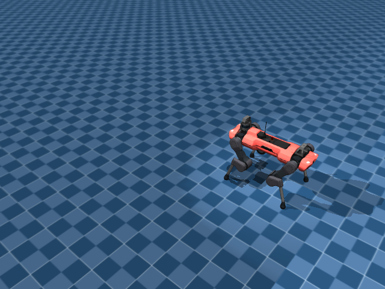
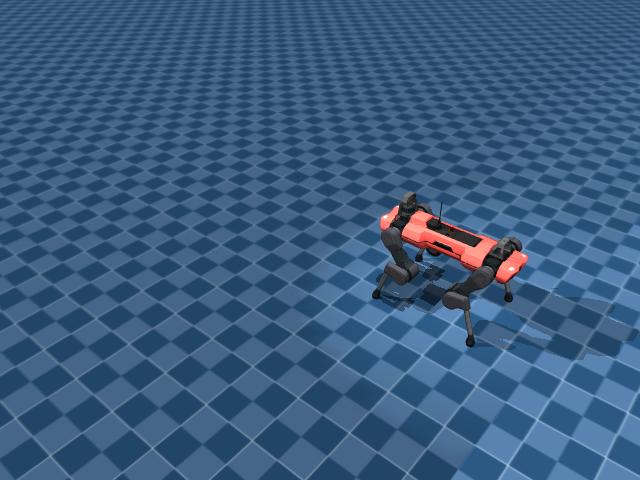
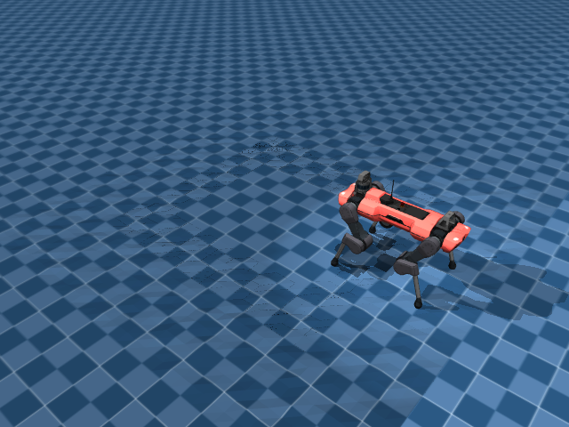
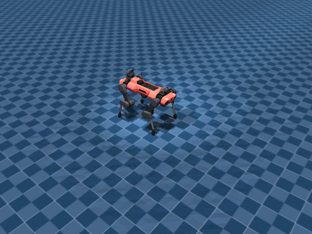

# 阶段 4：地形采样与恢复验收

复核日期：2026-11-13。已提交基线为 `6c71784`，本记录对应其后的阶段 4 工作区实现。

**业务实现、物理、短训练、恢复及真实 OpenGL 渲染均已通过，阶段 4 验收完成。**

## 交付内容

- 地形几何与采样策略分离，提供 `Fixed`、`Uniform`、`Curriculum`；同条件复用网格，支持单独换 patch 和重新选择出生位置。
- terrain 贡献类型和难度离散维度，通过通用 `get_bounds()` 消费课程分配；command 同实例联合、不同实例独立。
- 结算和候选分配提前到物理 reset 前，提交延后至 command、观测初始化成功；失败恢复课程、地形、物理、任务缓冲及随机进度。
- randomization 进入正式 task／runner 检查点，恢复首次 reset 重建当前地形和出生，不推进采样、不消耗请求；后续训练 reset 继续分配。
- 评估固定地形及其联合 cell；临时单环境播放保留来源环境的原始 patch 身份，不污染训练分配。
- ANYmal C 示例已接入联合课程。阶段 2／3 的独立物理诊断显式使用 Fixed，诊断参数仍仅写入输出目录。

职责沿用既有 manager：task 组织生命周期，randomization 决定条件与出生，curriculum 评价与分配，simulator 执行物理操作；runner 沿用原有环境快照和检查点入口。没有新增地形专用课程 manager。

## 验证结果

| 检查 | 结果 |
|---|---|
| MuJoCo/core 完整回归，保留真实渲染测试 | **1163 passed、11 skipped、47 deselected** |
| Isaac/core 回归 | **1097 passed、11 skipped、113 deselected** |
| 两侧 Pyright | **0 errors、0 warnings** |
| 反序局部 reset | 地形、联合 cell、实际命令采样均一致 |
| 失败注入 | 应用地形、物理 reset、出生、command、观测初始化失败后回滚；重试与无失败对照一致 |
| 状态与边界 | 缺失／不匹配版本、配置、seed、环境数、采样状态拒绝加载；平地路径保留；禁止单独 task reset 使地形课程失配 |
| 独立 Uniform | 按类型权重、均匀难度候选抽样；覆盖三类地形和两档难度，不消费训练 Torch 随机流 |
| 真实固定场景物理 | plane／slope／rough，两个阶段各 300 步，接触、安全出生及局部 reset 通过 |
| 真实渲染 | **通过：三类地形、变更后的画面及四种课程模式的真实回放** |

四种真实 PPO 模式均使用 4 个环境、64 步 rollout、32 步回合上限，完成 2 次初训更新和 2 次恢复更新，每种 1024 条转移。信号、损失和参数有限，续训参数发生变化，资源正常关闭。

| 模式 | 续训参数变化 L2 | 恢复、评估及播放 |
|---|---:|---|
| 独立 Uniform | 1.99068 | 通过 |
| 仅地形课程，命令 Uniform | 1.95533 | 通过 |
| command＋terrain 同实例联合课程 | 2.09144 | 通过 |
| command／terrain 两个独立实例 | 1.87384 | 通过 |

每种模式均经正式 runner 保存和加载检查点，精确对比当前高度场缓冲；恢复首次 reset 后逻辑状态不变，后续四次地形条件与 patch 分配相同。评估期间地形状态和请求不变；实际临时播放环境创建路径可将来源场景投影至单环境，并在多次 reset 后保持固定。原始结果见 [PPO 与恢复记录](verification.json) 和 [固定场景物理记录](fixed_physics.json)。

这些结果验证逻辑分配和几何重建，不表示完整机器人动力学轨迹与连续训练逐步相同，也不表示短训练策略已经收敛。Isaac 非平地仍待阶段 5 实现；本轮 Isaac 结果仅证明公共接口和平地回归。

## 渲染验收

本轮真实 OpenGL 上下文已恢复，未修改业务渲染代码或显卡配置。验收结果：

- 真实渲染测试通过；包含该测试的完整 MuJoCo/core 回归为 **1163 passed、11 skipped、47 deselected**，没有排除渲染用例。
- 三类地形及换 patch 后的画面已生成并逐张检查；默认坡地起伏较小，几何变化同时由高度缓冲断言核验。
- 地形改变后图像变化，renderer、相机及 OpenGL 上下文保持原实例，其他环境保持隔离。
- 四种课程模式均使用真实单环境回放生成图像，`render_verified` 全部为 true；其 PPO 初训、检查点恢复、续训及资源关闭正常完成。

最新记录见 [完整回归](mujoco_tests.log)、[四模式回放与训练](render_acceptance.log)、[三类地形与上传验证](geometry_render_acceptance.log)、[分配恢复结果](verification.json) 和 [几何渲染结果](fixed_physics.json)。此前 `WGL`／`gladLoadGL error` 属于历史阻塞，原始输出保留在 [失败日志](render_failure.log) 和 [当时的独立复验](render_retry.log)，不代表当前状态。

| 平地 | 坡地 |
|---|---|
|  |  |
| 起伏地形 | 换 patch 后 |
|  |  |

四模式的固定回放画面：[Uniform](images/uniform_playback.png)、[仅地形课程](images/terrain_only_playback.png)、[联合课程](images/joint_playback.png)、[独立实例](images/separate_playback.png)。

## 复跑

从项目根目录选择 `quadruped_rl` 解释器运行：

```powershell
python tests/manual/verify_terrain_curriculum.py --output-dir temp/stage4_mujoco
python tests/manual/verify_terrain_curriculum.py --output-dir temp/stage4_mujoco_render --render
python tests/manual/verify_mujoco_terrain.py --output-dir temp/stage4_fixed --steps 300
python -m pytest -m "core or mujoco" tests -q --basetemp temp/stage4_tests -p no:cacheprovider
```

上述入口已完成真实运行，阶段 4 的剩余渲染验收已关闭。生成的诊断 YAML、检查点和训练日志位于指定输出目录，不加入业务配置目录。

## 职责边界复核（2026-11-13）

- task 不再读取或裁剪课程 term 的 `assignments` 字段；单环境播放状态由 CurriculumManager 转发给对应 term，task 只组合 manager 返回的状态。
- TerrainAssignments 自行投影分配序列化，terrain term 只投影自身的出生、请求和初始化状态。
- 课程恢复失败时仍尝试恢复任务缓冲，并在清理后释放未完成事务标记；补充故障注入测试。
- randomization manager 在自己的播放投影入口校验索引，调用方无需保证其内部前置条件。

MuJoCo/core 完整回归为 1165 passed、11 skipped（包含真实渲染）；最终分配器投影调整后，相关采样、检查点及真实物理测试为 143 passed。Pyright 为 0 errors、0 warnings。此轮没有改变采样策略或物理渲染实现。

## 类型／难度独立采样轴（2026-11-13）

当前 YAML 使用 `sampling.terrain_type` 和 `sampling.difficulty`，每轴采用 `type + params`，只为 Curriculum 轴贡献离散维度。两轴可引用同一实例或不同实例；Fixed 的 `params.value` 分别填写类型名和难度索引。`resample_patch`／`resample_spawn` 留在 sampling 公共层。

每个轴分别支持 Fixed、Uniform、Curriculum。Fixed 未指定类型时首次按权重选择，之后即使难度变化也保持该类型。仅难度使用课程时仍允许独立抽取类型；仅类型使用课程时仍允许固定难度或独立抽取难度。待处理难度请求仅受难度轴的课程策略约束。

检查点保存完整轴配置，terrain 检查点外层版本提升为 2，不迁移此前的整体采样配置。阶段 4 上方的四模式记录为独立轴调整前的历史证据；最新结果为：

- MuJoCo/core：1172 passed、11 skipped、47 deselected，包含真实 OpenGL 测试。
- Isaac/core：1106 passed、11 skipped、113 deselected。
- Pyright：0 errors、0 warnings。
- 七模式真实 PPO 初训、恢复、续训、固定回放和渲染均通过：原有四模式，以及仅难度参与、仅类型参与、两轴不同实例。每模式 4 环境、2 次初训更新＋2 次续训更新，共 1024 条转移。
- 单元测试另外覆盖六种轴策略组合、首次恢复保持状态、后续分配对照和默认 Fixed 类型保持。

结果见 [按轴采样验收](axis_verification.json)、[渲染运行日志](axis_render.log)、[MuJoCo 回归](axis_mujoco_tests.log)、[Isaac 回归](axis_isaac_tests.log)。新模式实际图像：[仅难度课程](images/difficulty_only_playback.png)、[仅类型课程](images/type_only_playback.png)、[两轴不同实例](images/axis_separate_playback.png)。

## LocomotionTask 职责整理（2026-11-14）

- reset 只初始化任务 manager，不再依据 pending 状态决定是否结算／分配课程；课程调度固定在 before_simulator_reset。
- terrain 通过 CurriculumConsumerRequirements 声明持久分配需求，randomization 汇总，task 传递，curriculum 负责执行。task 不再从引用关系推断保留策略。
- 通用任务 manager 组合自身及 term 的 capture_reset_state；有状态 term 显式声明 RESET_STATE_FIELDS。任务快照不再扫描 vars(owner)，不包含配置、模型或采样器依赖。声明会合并继承层级，特殊对象可重写快照方法。
- 任务共享 Torch 随机状态由 TaskResetState 持有；manager／term 快照只负责自己的缓冲。正式检查点、课程临时统计和物理回滚仍由原来的领域模块负责。
- 新增字段声明边界测试，验证未声明配置不会被回滚；直接 task reset 不再重采样课程。

最终 MuJoCo/core：1177 passed、11 skipped；Isaac/core：1111 passed、11 skipped；Pyright：0 errors、0 warnings。七模式真实 PPO 初训、恢复、续训及固定回放渲染均通过。记录见 [七模式结果](task_decoupling_verification.json)、[MuJoCo 回归](task_decoupling_mujoco_tests.log)、[Isaac 回归](task_decoupling_isaac_tests.log) 和 [训练／渲染日志](task_decoupling_render.log)。

## Randomization 课程依赖注入统一（2026-11-14）

RandomizationManager 与 CommandManager 一样，在构造时接收 curriculum_manager，并在构建 term 时解析成只读 CurriculumSampler。task 不再调用 bind_curriculum，terrain term 不再接收整个课程 provider。配置不变而复用随机化实例时，config_update 先完整解析新的课程读接口，再刷新 term 引用；地形、请求、采样计数及物理绑定保持不变。simulator 的物理 bind 生命周期保持原样。

新增测试覆盖依赖刷新不改变分配和后端、构造时缺少课程依赖明确报错。最终 MuJoCo/core：1179 passed、11 skipped；Pyright：0 errors、0 warnings。

## 课程保留策略并入空间描述（2026-11-14）

当前实现以 CurriculumSpaceConfig.persistent_assignments 声明分配保留策略，默认 false。terrain 的课程轴声明 true；同一实例的多个空间贡献按逻辑或合并，构建后的 CurriculumSpace 将结果交给课程 manager。task 不再单独配置 consumer，CurriculumConsumerRequirements、get_curriculum_requirements 和 configure_consumers 已删除。此字段属于内部空间描述，不是新增 YAML 参数。

验证声明顺序反转不改变保留策略、独立 command 课程保持默认策略，以及原有恢复／评估／播放链路。MuJoCo/core：1182 passed、11 skipped；Isaac/core：1116 passed、11 skipped；Pyright：0 errors、0 warnings。七种模式真实 PPO 恢复及回放渲染均通过。结果见 [七模式记录](space_policy_verification.json)、[MuJoCo 回归](space_policy_mujoco_tests.log) 和 [Isaac 回归](space_policy_isaac_tests.log)。

## 统一临时快照协议（2026-11-14）

CurriculumManager 与其他任务 manager 统一继承 ResetStateManager，capture_reset_state 返回可 restore 的 ResetSnapshot。课程 term 通过显式字段快照和其拥有的 CurriculumBuffer／CellRewardStatistics 快照保存未结算回合、分配、统计和缓存；通用字段快照同时支持 torch.Generator，以恢复课程专用随机流。移除课程字典式 restore_reset_state，默认临时快照不再借用正式检查点加载。

LocomotionTaskLogic 删除 _PendingTaskReset，不再分别持有或恢复 curriculum 字典和普通缓冲。所有任务 manager 由同一 TaskResetState 组合。ResetStateBatch 尝试恢复全部子快照后统一报告异常，TaskResetState 始终尝试恢复共享 Torch 随机状态。公共快照协议和组合类统一从 utils/__init__.py 导出。

正式检查点与 randomization／simulator 的物理事务仍使用各自领域接口。完整 MuJoCo/core 1182 passed、Isaac/core 1116 passed，两侧各 11 skipped；Pyright 0 errors、0 warnings；七模式真实 PPO 恢复及固定回放渲染通过。证据见 [七模式结果](unified_snapshots_verification.json)、[MuJoCo 回归](unified_snapshots_mujoco_tests.log)、[Isaac 回归](unified_snapshots_isaac_tests.log)。

## Reset 索引顺序统一（2026-11-14）

顺序规范集中在 VectorEnv 的索引生成入口：局部 reset 使用一维 done mask 的 torch.nonzero，自然生成升序索引；完整 reset 使用 None，按自然环境顺序处理。删除 LocomotionTaskLogic.reset、CurriculumManager.finalize_episodes、resample 中的重复排序，无需额外 sort。

独立调用 task／manager 时按调用方提供的顺序处理，不再承诺任意反序输入产生相同的随机样本映射；相同种子和相同索引顺序仍可复现。此前反序等价记录为当时实现的历史结果，以本节约定为准。新增真实环境测试检查局部 reset 传入 [0, 2]；相关课程、恢复、地形和 VectorEnv 回归 206 passed。

## 所有已实现 manager 的声明式检查点（2026-11-14）

action、command、observation、reward、termination、task_state、curriculum、randomization 均接入 CheckpointStateOwner／CheckpointStateManager。公共机制负责字段提取、CPU 独立快照、加载预校验、字段恢复及 term 组合。六类通用 task manager 当前没有需要跨训练恢复的持久字段，保持空检查点，避免保存回合临时缓冲；BaseTask 会自动汇总未来显式声明的非空 manager 状态。

字段约定：STATE_FIELDS 为检查点与回滚共用，CHECKPOINT_STATE_FIELDS 仅用于持久化，RESET_STATE_FIELDS 仅用于事务回滚。检查点声明可使用字段名元组，或“保存路径 → 对象属性路径”映射。课程统计缓冲及自身学习统计／Generator 使用共享声明，避免保存与回滚各维护一份名单。字段名映射保留了现有课程和地形检查点结构。

特殊逻辑使用 _checkpoint_metadata、validate_checkpoint_state_dict、_before_checkpoint_load／_after_checkpoint_load；课程恢复后清理未完成回合、标记首次分配保留，terrain 重建几何、初始化标记及待应用状态。配置、版本、概率和分配范围继续执行领域校验。manager 在写入自身和任何 term 前完成字段校验及 term 加载前置守卫，不能用检查点加载代替临时回滚。

新增 tests/test_declarative_checkpoint.py，覆盖八类 manager、共享与用途专属字段、别名字段、快照独立性、元数据拒绝、加载整体预校验以及 BaseTask 接线。最终 MuJoCo/core 1199 passed、11 skipped；Isaac/core 1132 passed、11 skipped；两侧 Pyright 均为 0 errors、0 warnings；七模式真实 PPO 保存／恢复／续训及固定回放渲染通过。证据：[七模式结果](declarative_checkpoint_verification.json)、[MuJoCo 回归](declarative_checkpoint_mujoco_tests.log)、[Isaac 回归](declarative_checkpoint_isaac_tests.log)。

## 统一组合状态基类（2026-11-14）

全部八类已实现 manager 统一继承 StateManager，全部 term 基类统一继承 StateOwner，课程内部统计对象也使用 StateOwner。两者分别组合既有 ResetState／CheckpointState 基类，不混合恢复语义。未声明相应用途字段时不额外捕获或持久化该状态；randomization 同样具有两种能力，但物理前置、后置、提交和回滚仍由原事务执行。

公共入口位于 utils/state.py，并由 utils/__init__.py 导出。新增八类 manager 及其 term 能力一致性测试。完整 MuJoCo/core 1207 passed、11 skipped；Pyright 0 errors、0 warnings。

## 单一 ResetSnapshot（2026-11-14）

临时回滚对外只保留一种 ResetSnapshot 数据类。删除 ObjectResetState、ResetStateBatch、TaskResetState 和原 ResetSnapshot 协议；term、manager、task 捕获函数都返回同一类型。捕获时 extend 汇总为平铺数据，不嵌套不同快照包装。恢复时逐项尝试 Tensor、容器、属性和 Generator，最后汇总异常；共享 CPU／CUDA 随机状态也作为 Generator 记录加入同一快照。

StateOwner 继续声明字段，复杂对象通过 RESET_STATE_CHILDREN 声明需要同时捕获的内部对象；StateManager 默认包含自己的 terms。BaseLpacReward 仅声明 buffer、cell_statistics，不再自定义组合快照方法。task 只持有 ResetSnapshot，公共导出同步清理旧类型。持久检查点和物理引擎事务保持原有语义。

新增返回类型一致性和平铺结构测试，故障用例直接破坏一个课程缓冲，确认后续 manager 及共享随机状态仍尝试恢复。MuJoCo/core 1208 passed、11 skipped；Isaac/core 1141 passed、11 skipped；Pyright 0 errors、0 warnings；七模式真实 PPO 恢复与回放渲染通过。证据：[七模式结果](single_snapshot_verification.json)、[MuJoCo 回归](single_snapshot_mujoco_tests.log)、[Isaac 回归](single_snapshot_isaac_tests.log)。

## 课程消费者引用解析统一（2026-11-14）

command 与 randomization 共用 curriculum/sampling.py 中的 resolve_curriculum_samplers，统一 provider 校验、课程查找和只读协议检查。randomization 构造不再通过完整空间描述反推引用，使用 term 的 get_curriculum_references；运行时刷新使用同一采样配置的引用声明逻辑。terrain 的两种入口最终都由 TerrainSamplingConfig.curriculum_references 决定，manager 不解释类型／难度轴。删除 manager 级 curriculum_references 汇总接口。

新增测试禁止构造／刷新依赖时调用空间描述构建函数，确认两者互相独立。MuJoCo/core 1209 passed、11 skipped；Isaac/core 1142 passed、11 skipped；Pyright 0 errors、0 warnings。见 [MuJoCo 回归](curriculum_dependency_mujoco_tests.log)、[Isaac 回归](curriculum_dependency_isaac_tests.log)。

## Command／Randomization 表达形式统一（2026-11-15）

两者均使用 _build_terms → _get_term_kwargs → term 构造流程，显式传递 curriculum_manager。command 不再通过 kwargs.pop 取得 provider。课程引用统一由 term 类方法 get_curriculum_references 声明，删除 command/curriculum.py 及 uses_curriculum 标记；保留单命令轴与地形双轴的必要参数差异。随机化源配置也与 command 一样使用 deepcopy 隔离。

业务回归 MuJoCo/core 1208 passed、11 skipped，1 项既有真实 OpenGL 测试失败，沙箱外独立复验仍报告 WGL 驱动不支持 OpenGL／gladLoadGL error。Isaac/core 1142 passed、11 skipped；Pyright 0 errors、0 warnings。本轮没有修改物理或渲染逻辑，当前渲染环境失败单独记录，不当作通过。

2026-11-15 构造注入表达调整：command 和 randomization 均通过 kwargs 接收课程 provider，在 _get_term_kwargs 中提取并解析，只向 term 注入只读采样器；RandomizationManager.config_update 保留显式刷新参数。相关回归 119 passed，Pyright 0 errors、0 warnings。

## 课程依赖由 term 自行取用（2026-11-15）

CommandManager／RandomizationManager 运行时只转发 CurriculumTermProvider，不查找具体课程、不校验 sampler、不改写 curriculum 配置。两者不再需要 _get_term_kwargs 中的课程适配流程。课程 command term 根据自己的 curriculum 名称取得只读 sampler，terrain term 根据自身采样轴取得 sampler 集合；两者解析后只保存 sampler，不保留 provider。

RandomizationManager.config_update 只将 provider 转发给 term.config_update；terrain 完整解析新依赖后才替换自身引用，保留地形、请求及采样状态。空间描述仍由 manager 汇总。新增两类 manager 的透明转发测试，provider 的 get_term 只允许需要课程的 term 调用。

MuJoCo/core 1211 passed、11 skipped（本轮真实 OpenGL 测试通过）；Isaac/core 1144 passed、11 skipped；Pyright 0 errors、0 warnings。七模式真实 PPO 保存、恢复、续训及固定单环境状态验证通过，本次手工脚本未开启 --render。证据：[七模式结果](term_provider_verification.json)、[MuJoCo 回归](term_provider_mujoco_tests.log)、[Isaac 回归](term_provider_isaac_tests.log)。

## Term 实例名称统一（2026-11-15）

八类 manager 在创建 term 时统一传入 name，所有 term 基类接收名称并经 StateOwner 保存 self.name。未经过 manager 的直接构造可省略名称，默认使用类名；manager 始终传入配置条目键。实例名不自动写入持久字段，仍由配置及 manager 的 terms 字典确定身份。

课程 command 删除专用 term_name 参数和 dimension 别名，直接以 self.name 查询课程维度；播放包装 term 同样使用 self.name，删除 command_name 成员别名。测试覆盖同一 Uniform 类的两个不同名称实例，以及真实 MuJoCo 任务全部 manager 下 term.name 与字典键一致。

完整 MuJoCo/core 1213 passed、11 skipped；Isaac/core 1145 passed、11 skipped；相关命名／播放测试 41 passed；Pyright 0 errors、0 warnings。

## Term 名称改为必填（2026-11-15）

所有 term 基类及 terrain 构造的 name 参数不再提供默认值，StateOwner 删除类名兜底。manager 仍统一传入配置键；项目内直接构造 term 的测试调用已显式命名。缺少 name 立即报 TypeError，None、空字符串和非字符串报 ValueError。新增必填及非法名称测试。

最终 MuJoCo/core 1217 passed、11 skipped；Isaac/core 1149 passed、11 skipped；Pyright 0 errors、0 warnings。


## 2026-11-15 category / difficulty 子 term 整理

配置迁移为 `terrain.category` 和 `terrain.difficulty`，各自通过 `type + params.values` 持有候选与采样策略；不配置 difficulty 时固定为 1.0，不贡献课程维度。category 保留独立加权采样。课程内部使用离散编号，公开难度配置及 `set_difficulty()` 使用实际数值。重采样开关移至 terrain 层。

实现按 terrain.py、terrain_category.py、terrain_difficulty.py 分工，移除 terrain_sampling.py；未调整 env、task、curriculum 或 simulator 的业务结构。terrain 状态版本为 3，分配状态版本为 7，旧格式明确拒绝。

复跑 `tests/manual/verify_terrain_curriculum.py --output-dir temp/category_final_training --render`：七种独立／联合课程组合全部通过，各完成两次 PPO 更新、恢复后两次更新，并验证高度场精确重建、后续四轮分配一致、评估冻结及单环境播放和真实 OpenGL 渲染。结果见 [验证数据](category_difficulty_verification.json)。

MuJoCo/core：1233 passed、11 skipped、47 deselected；Isaac/core：1165 passed、11 skipped、115 deselected。两套 Pyright 均为 0 errors。两套测试各有同一个已有失败 `test_obsolete_group_selector_is_rejected`：测试要求拒绝旧 group 字段，而本次开始前已暂存的 command 实现已删除该检查；未回改该既有修改。日志见 [MuJoCo](category_difficulty_mujoco_tests.log)、[Isaac](category_difficulty_isaac_tests.log)。


## 2026-11-15 子 term 职责下沉复验

category、difficulty 自行解释和校验候选，返回类别名称与实际难度值；各自持有独立的采样计数，difficulty 保存数值形式的待处理请求，并在成功提交后清除。terrain 不再判断采样策略，不保存候选索引和难度请求；分配状态保存最终类别和实际难度。网格生成与资源范围计算继续属于 terrain。

子 term 使用公共 StateOwner 的状态声明，terrain 将其纳入 reset 子对象快照，并组合各自的检查点与单环境播放投影。terrain 状态版本为 4，分配状态版本为 8，先前格式明确拒绝。新增测试覆盖失败重试的状态一致性、子状态损坏时加载前拒绝，以及待处理难度请求的播放投影。

全量测试：MuJoCo/core 1237 passed、11 skipped、47 deselected；Isaac/core 1169 passed、11 skipped、115 deselected。两套 Pyright 均为 0 errors。日志见 [MuJoCo](delegated_axes_mujoco_tests.log)、[Isaac](delegated_axes_isaac_tests.log)。

七种实际训练、恢复、评估冻结和单环境播放组合全部通过真实 OpenGL 渲染复验；各组合包括恢复前后各两次 PPO 更新、精确高度场重建及后续四轮分配一致性检查，见 [验证数据](delegated_axes_verification.json)。复跑入口为 `tests/manual/verify_terrain_curriculum.py --output-dir temp/terrain_delegate_training --render`。


## 2026-11-15 category 策略约束

Uniform 保持原有加权采样；Fixed 的 values 必须只有一个类别并拒绝显式 weight，Curriculum 同样拒绝显式 weight。Fixed 直接选择唯一候选；配置导出为 Fixed/Curriculum 省略内部默认权重，能够重新解析。difficulty 规则未调整。ANYmal 配置和相关测试、诊断脚本同步迁移；多表面几何验收通过静态课程 bounds 指定各环境类别，不再依赖 Fixed 的首次随机选择。

新增 13 个策略约束与配置往返测试。MuJoCo/core 1250 passed、11 skipped、47 deselected；Isaac/core 1182 passed、11 skipped、115 deselected；两套 Pyright 均为 0 errors。七种真实训练、恢复和渲染组合全部通过，见 [验证数据](category_rules_verification.json)。额外三表面物理验收通过，并验证可见非平地的难度更新和高度场上传，见 [物理与渲染数据](category_rules_geometry.json)。


## 2026-11-16 三份 terrain 业务文件复审

修复物理回滚失败时提前丢弃快照的问题，失败后保留 pending 事务，允许重试回滚并阻止检查点或新操作覆盖未完成状态。纯 plane 逻辑采样也校验前后 reset 的环境集合。未完成 reset 时禁止提交新请求、重新绑定后端或更新依赖，避免请求被旧事务误清除；统一使用 `_ensure_no_pending_reset()` 检查。

双轴 provider 更新通过现有 StateOwner 快照协议回滚：后一个轴更新失败时，前一个轴也恢复原依赖。依赖绑定仅纳入 RESET_STATE_FIELDS，不进入检查点。Curriculum 难度拒绝含待处理请求的检查点，防止绕过课程分配；分配列表校验对损坏结构明确报错且不修改状态。

收敛 category/difficulty 的采样入口，按 Fixed、Curriculum、Uniform 直接返回领域值，仅 Uniform 计算独立随机数；移除冗余中间 sample_index 接口。terrain 的 patch 重建条件拆为选择改变与显式重建请求，去除重复筛选列表和单元素循环。子 term 的 config_update 参数形式与 terrain 保持一致。

新增 12 项回归测试，覆盖回滚失败重试、未完成事务保护、纯平地 reset 配对、恶意请求注入、依赖更新原子性及损坏分配列表。MuJoCo/core：1262 passed、11 skipped、47 deselected；Isaac/core：1194 passed、11 skipped、115 deselected。两套 Pyright 均为 0 errors。日志见 [MuJoCo](terrain_audit_mujoco_tests.log)、[Isaac](terrain_audit_isaac_tests.log)。

七种真实训练、恢复、评估冻结和单环境播放组合全部通过 OpenGL 渲染验收，见 [验证数据](terrain_audit_verification.json)；复跑命令为 `tests/manual/verify_terrain_curriculum.py --output-dir temp/terrain_audit_training --render`。


## 2026-11-19 阶段最终复核

以当前工作区和当前 YAML 为准，复核了 task／manager／term／simulator 的职责边界、category/difficulty 的候选与策略规则、联合空间和 reset 事务、检查点恢复、评估冻结及单环境播放。本轮未发现新增的阻塞性业务错误；同步修正 temp/阶段计划.md 中旧 sampling/types/difficulty_levels、Fixed value、多模式数量及旧回归计数的现行说明，历史条目保留。

完整回归：MuJoCo/core 1269 passed、11 skipped、47 deselected；Isaac/core 1201 passed、11 skipped、115 deselected；两套 Pyright 均为 0 errors。七种实际 PPO 初训＋恢复、四轮后续分配一致性、高度缓冲精确重建、评估冻结、单环境播放和 OpenGL 渲染全部通过；额外三地形物理和可见高度场上传验收也通过。完整结果及三份 terrain 源文件校验和见 [最终验证数据](final_review_20261119.json)，回归日志见 [MuJoCo](final_review_20261119_mujoco.log)、[Isaac](final_review_20261119_isaac.log)。

阶段 4 已满足当前验收目标；短训练证明流程可用，不证明策略收敛。Isaac 非平地链路属于阶段 5，摩擦和台阶属于待实施扩展，跨后端性能与交付属于阶段 6。
